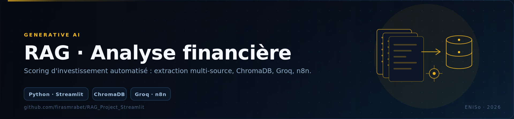
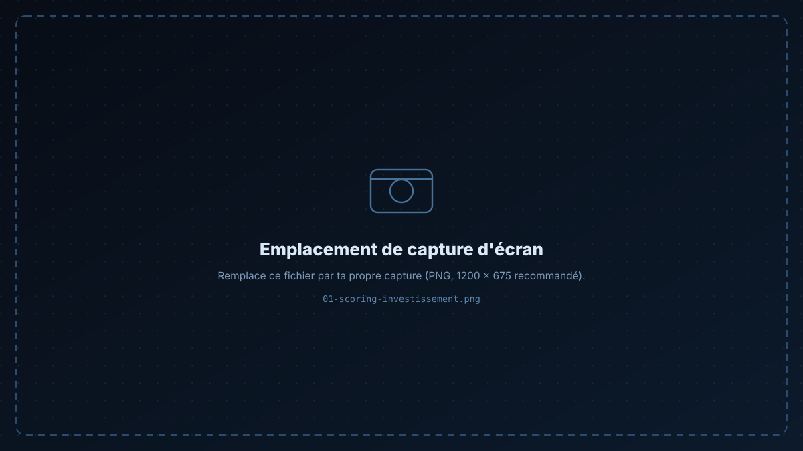
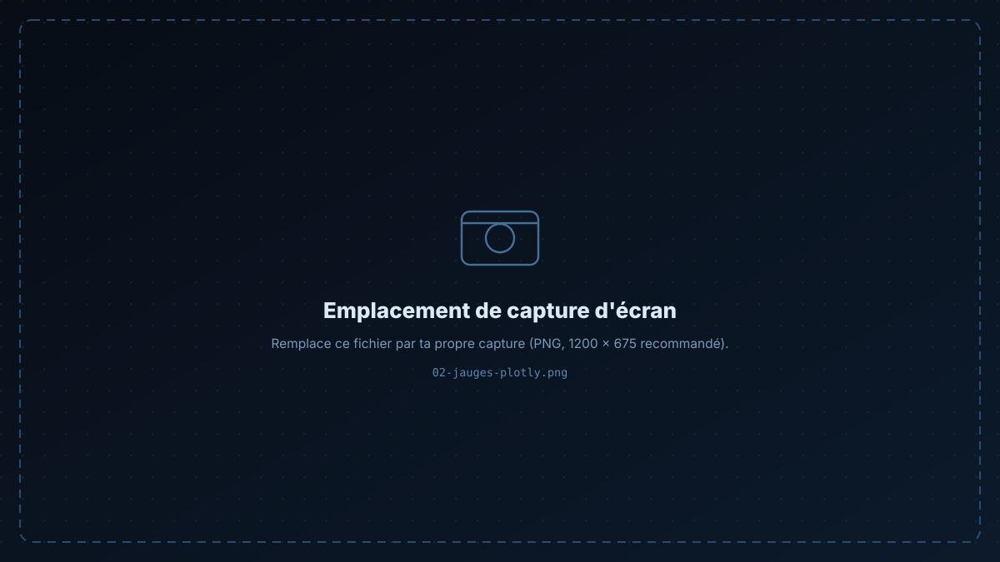

<p align="center">
  
</p>

<p align="center">
  
  
  
  
  
  
</p>

<h1 align="center">RAG — Analyse financière automatisée</h1>

<p align="center">
À partir d'une <b>data room</b> hétérogène (PDF, Excel), le pipeline extrait, indexe et interroge les documents<br/>
pour produire un <b>scoring d'investissement</b> argumenté — et le même workflow automatisé dans <b>n8n</b>.
</p>

<p align="center">
  <a href="#-fonctionnalités">Fonctionnalités</a> ·
  <a href="#-pipeline">Pipeline</a> ·
  <a href="#-démarrage">Démarrage</a> ·
  <a href="#-automatisation-n8n">n8n</a>
</p>

---

## 📸 Captures

<p align="center">
  
  
</p>

---

## ✨ Fonctionnalités

- **📥 Ingestion multi-source** — PDF (statuts, contrats, états financiers NCT 2023-2025, registre du personnel, étude de marché) et classeurs Excel (business plan).
- **🧩 Découpage & embeddings** — chunking des documents puis vectorisation avec `sentence-transformers`, stockage dans **ChromaDB**.
- **🔎 Récupération augmentée** — les passages pertinents sont récupérés puis envoyés, avec un prompt structuré, au LLM **Groq**.
- **📊 Scoring d'investissement** — note globale et sous-scores, **jauges Plotly** pour la lecture visuelle, export **JSON** des résultats.
- **🧠 Robustesse** — similarité de chaînes (`SequenceMatcher`) et fallback de modèle pour garder une sortie exploitable quand une source manque.

---

## 🔁 Pipeline

```
 data room (PDF · XLSX)
          │
          ▼
   ingest.py  ── extraction + nettoyage ──▶ chunking
                                              │
                                              ▼
                                embeddings.py (sentence-transformers)
                                              │
                                              ▼
                                         ChromaDB
                                              │
                 question ──▶ retrieval ──────┘
                                 │
                                 ▼
                        prompt structuré ──▶ Groq (LLM)
                                 │
                                 ▼
                scoring + justification ──▶ Plotly · export JSON
```

### Structure

```
├── app.py                     # interface Streamlit (scoring, jauges, export)
├── fallahtech_rag/
│   ├── ingest.py              # extraction et découpage des documents
│   ├── embeddings.py          # vectorisation + base ChromaDB
│   └── data/                  # data room (PDF, XLSX)
├── FallahTech_RAG_Colab_code.ipynb   # version notebook (expérimentation)
├── .streamlit/config.toml     # thème de l'interface
└── requirements.txt
```

---

## 🚀 Démarrage

```bash
# 1 — environnement
python -m venv .venv && source .venv/bin/activate
pip install -r requirements.txt

# 2 — clé API Groq (gratuite sur console.groq.com)
cp .env.example .env          # renseigner GROQ_API_KEY

# 3 — (une fois) construire l'index vectoriel à partir de fallahtech_rag/data/
python -m fallahtech_rag.ingest

# 4 — lancer l'application
streamlit run app.py
```

> Le notebook `FallahTech_RAG_Colab_code.ipynb` permet de rejouer tout le pipeline sur Google Colab, sans installation locale. Un `.devcontainer` est également fourni.

---

## 🤖 Automatisation n8n

Le même pipeline existe sous forme de **workflow n8n** :

1. **Google Drive** — déclencheur sur dépôt de nouveaux documents ;
2. **chunking** et appels LLM par lots (*batch prompting*) ;
3. **fallback** automatique vers un modèle secondaire si un appel échoue ;
4. **génération du rapport** final et notification.

L'objectif : passer d'un script lancé à la main à un traitement **déclenché par le dépôt de fichiers**, sans intervention humaine.

---

## 🛠 Stack

Python · Streamlit · ChromaDB · sentence-transformers · Groq API · Plotly · pypdf · openpyxl · n8n

---

<div align="center">

**Firas Mrabet** — Élève ingénieur en informatique appliquée @ ENISo

[GitHub](https://github.com/firasmrabet) · [LinkedIn](https://www.linkedin.com/in/firas-mrabet-98779934b) · [Portfolio](https://firas-mrabet-portfoliowebsite.vercel.app) · [Email](mailto:firasmrabet1603@gmail.com)

</div>
